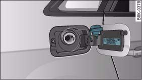
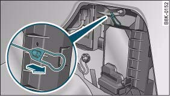

Para abrir, destrave o veículo pelo travamento central e pressione o lado esquerdo da portinhola. Depois, gire a tampa do tanque no sentido anti-horário; o manual também orienta apoiá-la na portinhola aberta.

Fonte: Manual do audi a4 2008, página 254.

## Imagens exibidas

