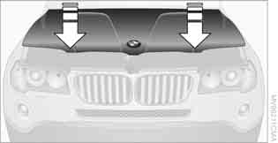

Puxe a alavanca localizada sob o lado esquerdo do painel de instrumentos. Depois, vá à dianteira do veículo, pressione a trava de liberação e levante o capô. Antes de abrir, confirme que os braços dos limpadores estão apoiados no para-brisa.

Fonte: Manual do bmw x3 2007, página 99.

## Imagens exibidas

