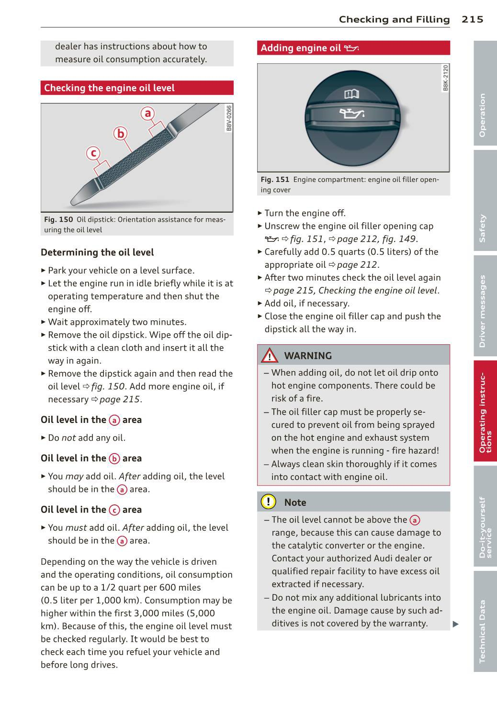

Desligue o motor e não continue dirigindo. Verifique o nível do óleo: se estiver baixo, complete e só prossiga se o aviso apagar. Se o nível estiver correto e o aviso continuar aceso, mantenha o motor desligado e procure uma concessionária Audi ou oficina qualificada.

Fonte: Manual do audi a3 2015, página 22.

## Imagens exibidas

