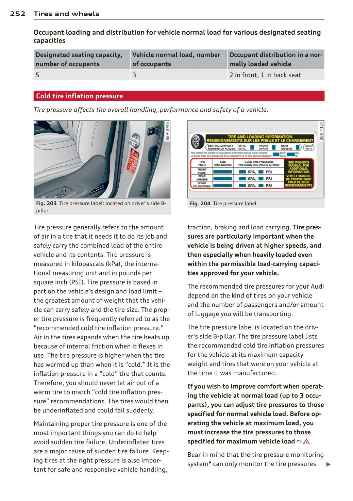
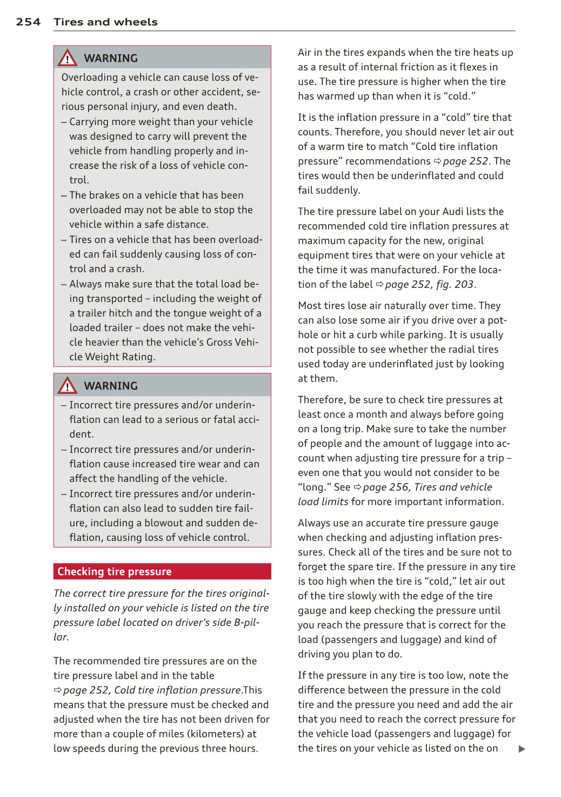

A pressão correta do estepe está na etiqueta de pressão dos pneus fixada na coluna B do lado do motorista, o pilar entre as portas dianteira e traseira desse lado.

Fonte: Manual do audi q5 2013, página 255.

## Imagens exibidas

