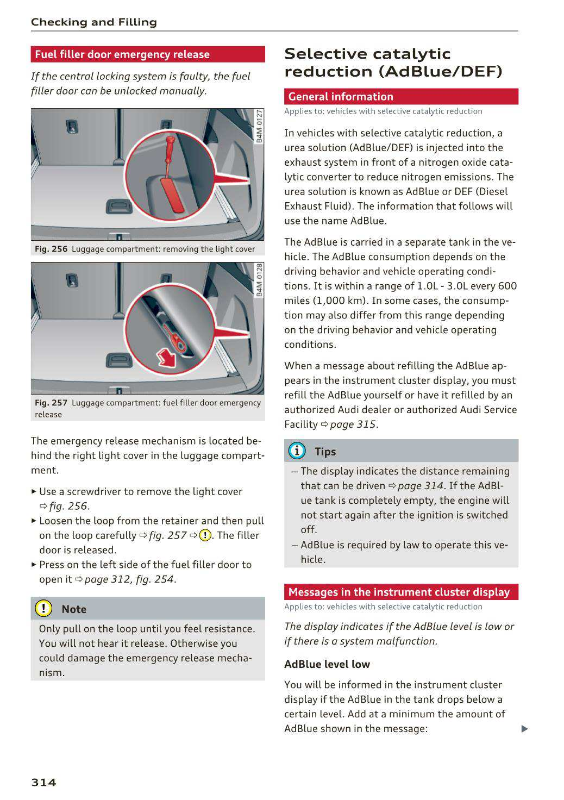

No porta-malas, localize o mecanismo atrás da cobertura da lanterna direita. Remova essa cobertura com uma chave de fenda, solte a alça do suporte e puxe-a com cuidado somente até sentir resistência. Em seguida, pressione o lado esquerdo da portinhola do tanque para abri-la. Não force a alça além da resistência, pois isso pode danificar o mecanismo de emergência.

Fonte: Manual do audi q7 2018, página 316.

## Imagens exibidas

