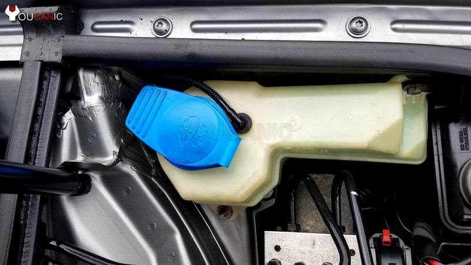
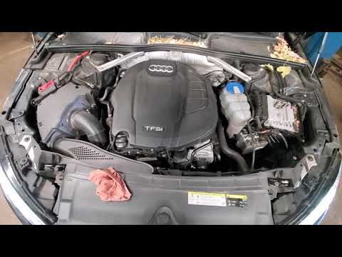
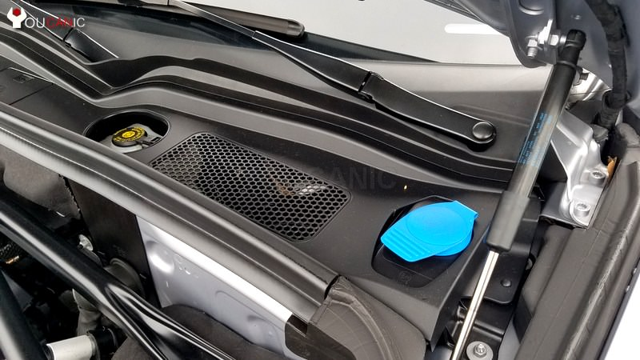

No Audi A4 2018 (geração B9), o reservatório do limpador de para-brisa fica no vão do motor, e a tampa tem algumas características que ajudam a identificá-la:

**Como reconhecer:**

- Fica no lado esquerdo ou direito do compartimento do motor (geralmente próximo à lateral, perto do para-lama), dependendo da configuração do mercado.
- A tampa é de plástico azul (ou às vezes preta), menor que a do óleo e a do fluido de arrefecimento.
- Tem o desenho de um **para-brisa com jatos de água** (ícone de “spray”) gravado ou impresso na própria tampa — esse é o principal identificador visual.
- É rosqueada (gira para abrir), sem trava ou alavanca como a do óleo.

**Dica prática:**

- Abra o capô e localize a tampa próxima à frente do vão do motor, geralmente do lado do para-lama.
- Ela costuma ter o símbolo do para-brisa com respingos de água (parecido com um ícone de spray).
- Diferente da tampa do óleo (que é maior e geralmente preta com texto “Engine Oil” ou símbolo de lata de óleo) e da tampa do arrefecimento (que fica mais central, perto do radiador e tem aviso de “não abrir a quente”).

Se quiser, posso te ajudar a confirmar a localização exata olhando o manual do proprietário ou um diagrama específico do motor (2.0 TFSI, 2.0 TDI etc.) — é só me dizer qual motorização você tem.
