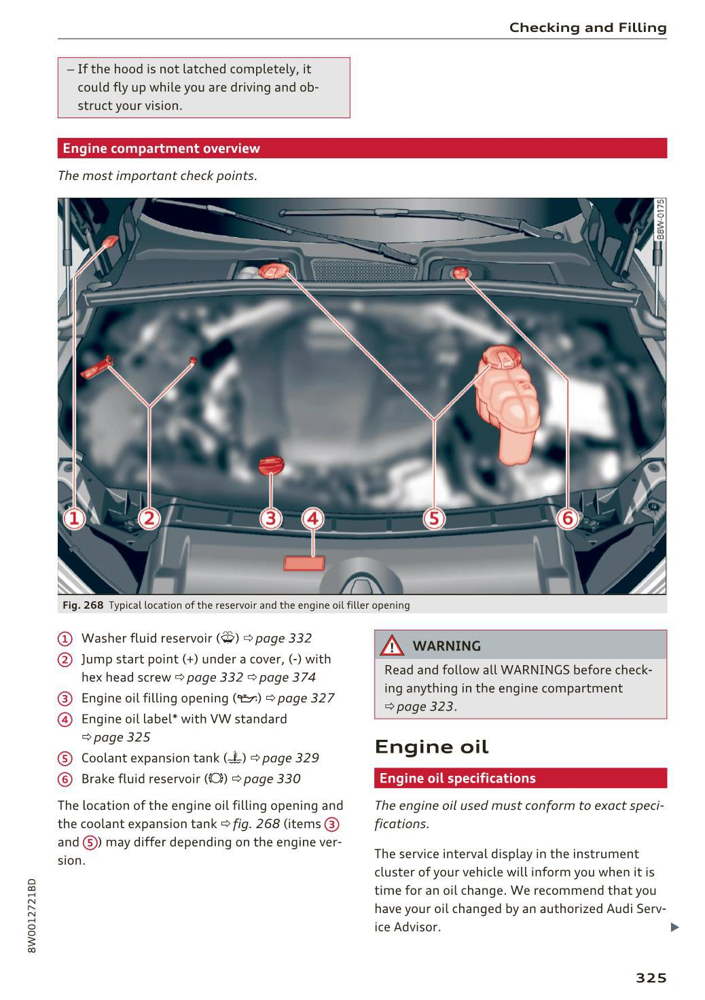

No compartimento do motor, procure a tampa marcada com o símbolo de um para-brisa recebendo jatos de água. Ela fecha o reservatório do limpador de para-brisa e, quando equipado, do lavador dos faróis.

Fonte: Manual do audi a4 2018, página 333.

## Imagens exibidas

