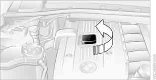
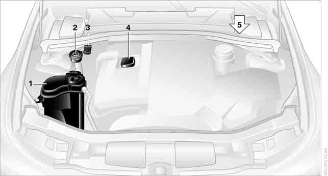

Conecte o cabo positivo ao terminal de partida auxiliar no compartimento do motor. Esse ponto funciona como polo positivo da bateria e fica sob uma tampa marcada com o sinal +; levante a tampa antes de conectar o cabo.

Fonte: Manual do bmw 330 2006, página 134.

## Imagens exibidas

